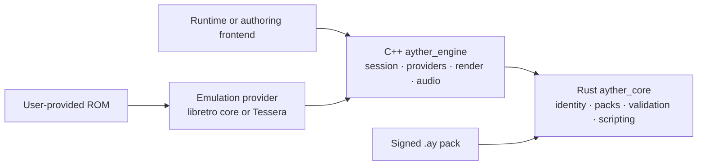

# AYTHER Engine


AYTHER Engine is the open-source engine behind real-time audiovisual remastering
of retro 2D games. It observes the graphics, memory, and sound an emulator
produces, derives deterministic identities from them, and resolves those
identities to replacement assets stored in a separate `.ay` content pack. The
original ROM is never modified or redistributed.

> [!WARNING]
> **Pre-release software.** Engine `0.1.0` is published only as release
> candidates. The API, ABI, pack format, and security model are not yet a
> production commitment; see [Project status](docs/PROJECT_STATUS.md).

## Status

| Area | State |
|---|---|
| Rust core (`ayther_core`) | Implemented: identities, substitution, packs, trust, scripting, patches, SoundFonts |
| C++ engine (`Ayther::engine`) | Implemented: session, emulation providers, Vulkan renderer, SDL audio, rewind, takes |
| Emulation providers | User-supplied libretro core (all builds); optional Tessera native provider for the Mega Drive (Windows x64) |
| Installable package | `find_package(Ayther)` with `Ayther::core`, `Ayther::engine`, `Ayther::ymfm`, and `Ayther::vpx` in VPX builds |
| Platforms | Windows and Linux x86_64, tested in CI |
| Releases | Signed pre-releases; latest `v0.1.0-rc.28` and native candidate `native-v0.1.0-rc.28` |
| Stable release | Not available; open blockers are listed in [Project status](docs/PROJECT_STATUS.md#release-blockers) |

## Architecture at a glance



The session reads either provider through one internal observation interface,
so identities and substitutions behave the same whichever emulator runs the
game. See [Architecture](docs/ARCHITECTURE.md) for data flow, module map, and
trust boundaries, and [Tessera native provider](docs/TESSERA_NATIVE.md) for the
optional native core.

## Build and test

Install the toolchain described in the
[development environment guide](docs/DEVELOPMENT_ENVIRONMENT.md). The Rust
toolchain is pinned by `rust-toolchain.toml`.

```text
cargo fmt --all -- --check
cargo clippy --workspace --all-targets --locked -- -D warnings
cargo test --workspace --all-targets --locked

cmake --preset windows-native
cmake --build --preset windows-native
ctest --preset windows-native --output-on-failure
```

Headless presets build the core and its C++ ABI oracle without native
dependencies; native presets build the complete engine through the pinned vcpkg
manifest; `*-native-vpx` presets add the VP9 decoder. Linux presets mirror the
Windows ones. All presets, release packaging, and CI gates are documented in
[Build, test, and release](docs/BUILD_TEST_RELEASE.md).

## Security and content trust

Treat packs, scripts, ROMs, patches, emulator cores, and media as untrusted
input. Validation happens before a pack becomes active. Debug builds allow
unsigned packs with a warning; release builds reject them and the public test
key. Production hosts supply an explicit trust registry.

Read the [pack and security model](docs/PACK_SECURITY_MODEL.md) before
integrating Engine, and report vulnerabilities privately as described in
[SECURITY.md](SECURITY.md).

## Legal boundaries

AYTHER Engine does not provide ROMs, BIOS images, commercial game assets, or
third-party emulator cores. Users and pack authors are responsible for having
the rights required for every input and distributed asset. AYTHER Tessera,
Runtime, Lab, Play CE, and Web are separate products with their own
repositories, licenses, and releases.

The source in this repository is licensed under MPL-2.0; dependencies keep their
own licenses. The MPL grants no trademark rights and does not license
third-party game content. See
[Legal and distribution boundaries](docs/LEGAL_AND_DISTRIBUTION.md),
[LICENSE](LICENSE), and [NOTICE.md](NOTICE.md).

## Documentation

Start at the [documentation index](docs/README.md). Common entry points:

- [Project status](docs/PROJECT_STATUS.md) — what works, what is missing, and
  the release blockers;
- [Architecture](docs/ARCHITECTURE.md) — components, providers, data flow, and
  invariants;
- [API and compatibility](docs/API_COMPATIBILITY.md) — API surfaces, version
  axes, and stability rules;
- [Tessera native provider](docs/TESSERA_NATIVE.md) — configuration, lock,
  capabilities, packaging, and parity testing;
- [Build, test, and release](docs/BUILD_TEST_RELEASE.md) — commands and release
  gates;
- [Support matrix](docs/SUPPORT_MATRIX.md) — tested platforms and toolchains;
- [Changelog](CHANGELOG.md) — what changed in each release.

## Contributing

Read [CONTRIBUTING.md](CONTRIBUTING.md) before changing code or contracts. Keep
Rust, generated bridge declarations, C++ headers, ABI tests, and documentation
in the same change whenever a shared type or function changes.
