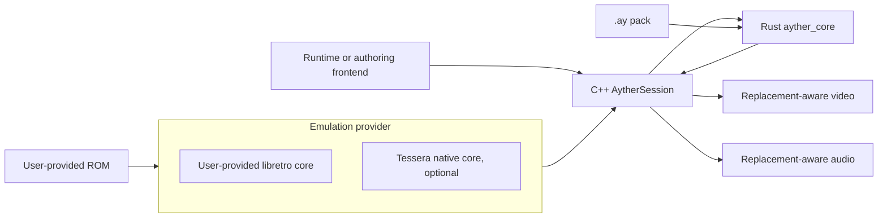
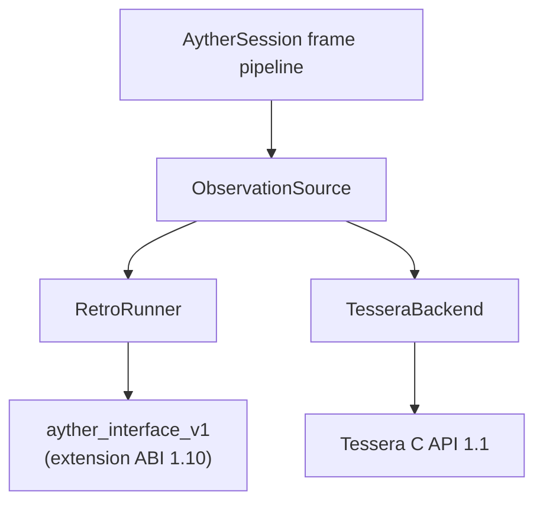

# Architecture

**Status:** implemented, pre-release (`0.1.0` release candidates)

**Last reviewed:** 2026-11-19

AYTHER Engine observes the output and state of an emulated game, derives stable
identities from that observation, and resolves those identities to optional
replacement assets. It does not modify the source ROM and does not own product
distribution, authoring UI, or emulator-core distribution.

Current maturity, test evidence, and release blockers are in
[Project status](PROJECT_STATUS.md); this document describes structure.

## System context

The frontend owns user interaction and process lifecycle. The C++ layer owns
real-time orchestration, emulator hosting, and native multimedia. The Rust core
owns deterministic identity, substitution policy, content-pack semantics,
validation, scripting, and format-heavy operations.

## Component boundaries

| Component | Responsibilities |
|---|---|
| `ayther_core` (Rust) | Identities, substitutions, pack VFS, validation and trust, scripting, ROM patches, SoundFont processing, CXX bridge, flat C ABI |
| `Ayther::core` | Installed static archive and C header for native consumers |
| `Ayther::engine` | Session facade, emulation providers, Vulkan renderer, SDL audio, rewind and recording, component wiring |
| `Ayther::ymfm`, `Ayther::vpx` | Vendored FM synthesis target; optional VP9 decoder (VPX builds only) |
| AYTHER Tessera | Separate repository; optional native emulator consumed as an installed package |
| AYTHER Runtime, Lab, Play, Web | Separate products that consume Engine |

Core and engine form one technical provider. Public consumers enter through the
engine-owned facade and the headers listed in the
[public API index](PUBLIC_API_INDEX.md); direct use of the broad core ABI is an
expert, unstable path. The boundary rationale is
[ADR 0001](adr/0001-core-and-engine-component-boundary.md).

## Emulation providers

An `AytherSession` gets frames, memory, and sound from exactly one emulation
provider, chosen at creation through `AytherSession::Config::provider`:

| Provider | Selector | Source of the emulator | Availability |
|---|---|---|---|
| libretro | `EmulationProvider::libretro` (default) | A user-supplied libretro core loaded at run time. An AYTHER-aware core adds the [emulator extension ABI](EMULATOR_EXTENSION_ABI.md); a stock core gives reduced observation | Every Engine build |
| Tessera native | `EmulationProvider::tessera_native` | The installed Tessera package linked into Engine; Mega Drive backend | Builds with `AYTHER_ENABLE_TESSERA=ON` (Windows x64) |

Both providers implement one internal interface, `ObservationSource`
(`include/ayther/observation/observation_source.h`, not installed):

The interface carries the observation primitives — region queries and reads,
control writes, frame snapshots, recomposition, audio-event polling,
subscriptions, and frame deltas. Snapshot validation, sprite reads, audio
polling policy, and controls are implemented once on top of it, so a
`FrameView` is built by the same code whichever provider produced it. A
provider that lacks a primitive reports it as unsupported; the session never
switches providers to compensate.

The native provider's configuration, lock, capabilities, and tests are
documented in [Tessera native provider](TESSERA_NATIVE.md).

## Runtime data flow

1. A caller supplies a ROM, a provider selection (a libretro core or a native
   configuration), configuration, and an optional pack.
2. The provider produces video, audio, and memory observations.
3. Identity modules normalize those observations into deterministic keys.
4. Conditions, profiles, and scripts provide bounded runtime context.
5. Substitutors resolve keys to pack assets or retain the original output.
6. The engine composites graphics, schedules audio, and presents the frame.

Failure to load or resolve optional replacement content preserves original
emulator output where safe. Trust failures, incompatible schemas, invalid FFI
inputs, and required-resource failures are explicit; they are never silently
downgraded to successful activation.

## Session and renderer boundary

`AytherSession` owns emulation, identity state, substitutions, scripting,
recording, and the CPU-visible result of a frame. It exposes that result as a
plain-data `FrameView`. It does not own Vulkan and stays usable in headless
tests.

Pack inspection, validation, render-tier selection, and file watching cross the
Runtime boundary through `engine/pack.hpp`. `PackInfo` and validation findings
own their strings, `PackWatcher` owns and releases the platform watcher, and
`PackView` is a non-owning token whose lifetime is bounded by its session. The
flat core ABI and archive handles are implementation details for C++ consumers;
`ayther_core_ffi.h` is installed only as an explicit C ABI.

`AytherRenderer` is a separate, device-dependent object. It consumes a
`FrameView` and typed `PackView`, records work into a caller-provided command
buffer, and renders to an offscreen image. A frontend may present that image,
sample it in another UI, or read it back. Presentation policy stays outside the
session.

The application owns its Vulkan instance, device, allocator, and presentation
objects. It lends Engine a `VulkanContextView` containing only the graphics
handles needed to render; surfaces and swapchains never cross that boundary.
The borrowed handles must outlive every renderer resource. Renderer operations
are thread-affine, and before resize, replacement, or destruction the caller
ensures submitted GPU work no longer references affected resources. The
lifecycle is documented in
[C++ API and implementation contracts](CPP_API_REFERENCE.md).

Hosts that need per-frame evidence of what was replaced, or that restore a
session mid-game, use the [render observation](RENDER_OBSERVATION.md) and
[visual state](VISUAL_STATE.md) contracts.

## Determinism contract

Given the same ROM bytes, the same provider and emulator build, initial state,
pack, configuration, and ordered input stream, headless session stepping
produces the same deterministic state and identity observations. Rendering may
vary with GPU implementation details but never feeds back into simulation.

Savestate verification compares direct continuation with serialize → restore →
re-simulate. Tests use frame-based clocks and stable fixtures. Wall time,
audio-device cadence, filesystem iteration order, and unordered-container
iteration must not alter simulation identity.

Determinism is conditional on the emulator and every input participating in the
run. It is not a claim that arbitrary cores, drivers, or external scripts are
deterministic. Recordings carry the emulation generation (for example
`tessera` plus the backend build ID) so a take is replayed against the emulator
that produced it.

## Core module map

| Area | Modules |
|---|---|
| Graphics identity | `tile_substitutor`, `sprite_hasher`, `vram_sprite`, `shape_hash`, `background`, `animation`, `identity_kat` |
| Audio identity and playback data | `audio_hasher`, `audio_event`, `instrument_map`, `sf2`, `sf2_bake`, `sf3`, `sfz` |
| Context and matching | `conditions`, `memory_aob`, `ram_anchor`, `game_profile`, `widescreen_gate` |
| Content packs | `archive_vfs`, `pack_builder`, `pack_validate`, `pack_security`, `pack_trust`, `pack_credits`, `file_watcher` |
| Scripting and patches | `script_env`, `rom_patch`, `cheat_code` |
| Session state | `state_codec` (serialized visual-state sections) |
| Native boundaries | `ffi` for `cxx`; `lib` for the flat C ABI and crate facade |

Grouping and contextual resolution across these modules are specified in
[Component model](COMPONENT_MODEL.md). Bit-exact keys are specified in
[Pack identity specification](IDENTITY_SPECIFICATION.md). The generated
[dependency graph](DEPENDENCY_GRAPH.md) lists crate and target edges.

## Trust boundaries

- Packs, scripts, ROMs, patches, emulator cores, and media are untrusted input.
- Raw pointers cross the flat C ABI; validation cannot make an invalid pointer
  safe. The caller owns pointer validity, alignment, lengths, and lifetimes.
- Lua runs in a reduced environment with instruction and memory limits, but it
  is still attacker-controlled computation.
- A valid signature proves integrity relative to a trusted key; it does not
  grant content rights or establish that an emulator core is safe.
- Dynamic libretro-core loading belongs to the engine layer. The Tessera
  provider is linked at build time against a locked, checksummed package rather
  than loaded from a user-supplied path.

The pack trust model is detailed in [Pack and security model](PACK_SECURITY_MODEL.md).

## Architectural invariants

1. Deterministic input produces deterministic identity independent of asset
   presentation.
2. Content packs contain replacement material, never the game ROM or BIOS.
3. Patches apply in memory; the source ROM remains unchanged.
4. Both providers feed the session through `ObservationSource`; a provider
   failure is reported, never answered by switching providers.
5. Core handles are single-threaded unless a type explicitly documents another
   contract.
6. Shared layouts use fixed-width fields and compile-time C++ assertions.
7. Optional enhancement failure never authorizes bypassing signature, schema,
   path, or bounds checks.
